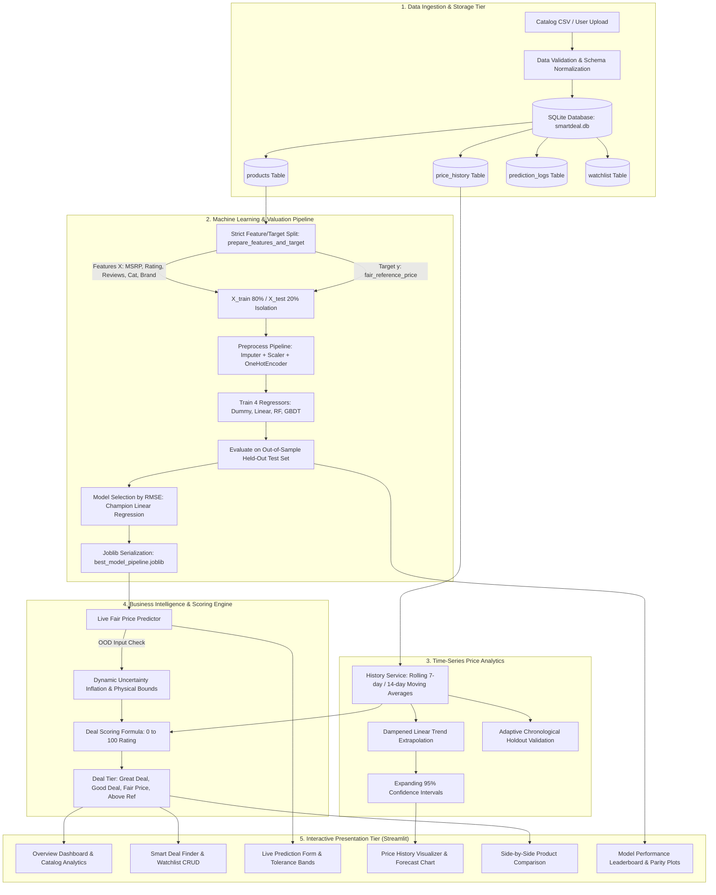

# SmartDeal AI — E-Commerce Price Prediction & Smart Deal Finder

<div align="center">

[](https://www.python.org/)
[](https://streamlit.io/)
[](https://scikit-learn.org/)
[](https://www.sqlite.org/)
[-brightgreen?logo=pytest&logoColor=white)](https://pytest.org/)
[](.github/workflows/ci.yml)
[](https://kowshiii1208.github.io/smartdeal-ai/)
[](https://share.streamlit.io/deploy?repository=kowshiii1208/smartdeal-ai&branch=main&mainModule=app.py)
[](LICENSE)

**An intelligent decision intelligence platform that protects online shoppers from deceptive pricing by predicting intrinsic fair reference prices and scoring deals on an objective 0–100 scale.**

[🌐 Launch Live Web App (GitHub Pages)](https://kowshiii1208.github.io/smartdeal-ai/) • [🚀 Deploy on Streamlit Cloud](https://share.streamlit.io/deploy?repository=kowshiii1208/smartdeal-ai&branch=main&mainModule=app.py) • [📖 Viva & Interview Guide](PROJECT_EXPLANATION.md)

</div>

---

## 📑 Table of Contents

1. [Problem Statement & Core Value](#-problem-statement--core-value)
2. [Live Deployments & Interactive Demos](#-live-deployments--interactive-demos)
3. [Key System Capabilities](#-key-system-capabilities)
4. [5-Tier System Architecture](#-5-tier-system-architecture)
5. [Machine Learning Valuation Engine](#-machine-learning-valuation-engine)
6. [Empirical Model Benchmark Leaderboard](#-empirical-model-benchmark-leaderboard)
7. [Transparent 0–100 Deal Scoring Formula](#-transparent-0100-deal-scoring-formula)
8. [Multi-Page Application Walkthrough](#-multi-page-application-walkthrough)
9. [Project Directory Layout](#-project-directory-layout)
10. [Local Setup & Quickstart](#-local-setup--quickstart)
11. [Automated Testing Suite](#-automated-testing-suite)
12. [Ethical Data Provenance & Limitations](#-ethical-data-provenance--limitations)
13. [Placement Viva & Interview Defense Guide](#-placement-viva--interview-defense-guide)
14. [Contributing & License](#-contributing--license)

---

## 🎯 Problem Statement & Core Value

In modern e-commerce marketplaces (Amazon, Flipkart, Croma, Reliance Digital), shoppers face constant marketing deception:

1. **Inflated MRP Anchoring:** Sellers frequently double or triple the Manufacturer's Suggested Retail Price (MRP). An item with an everyday market price of ₹1,000 is marked with an artificial ₹2,500 sticker price so that a ₹1,200 offer appears to carry an eye-catching "52% OFF" tag.
2. **Deceptive Urgency Badges:** Algorithmic banners ("Deal of the Day", "Lightning Offer", "Only 2 Left") manufacture psychological urgency without reflecting genuine price cuts against historical trends.
3. **Lack of Intrinsic Valuation:** Buyers lack an independent mathematical benchmark to determine what a product with specific technical specifications, brand equity, and customer feedback *ought* to cost at market equilibrium.

**SmartDeal AI** decouples deal detection from retailer-manipulated MRPs. By learning fair benchmark reference prices through regression pipelines and comparing current offers to historical price distributions, it reveals whether a discount is a genuine bargain or marketing smoke.

---

## 🌐 Live Deployments & Interactive Demos

SmartDeal AI offers two deployment pathways:

| Deployment Platform | URL / Access | Description |
| :--- | :--- | :--- |
| **GitHub Pages (Zero-Server Web Client)** | 🔗 **[kowshiii1208.github.io/smartdeal-ai](https://kowshiii1208.github.io/smartdeal-ai/)** | Instant browser deployment with catalog browsing, interactive deal search, live fair price calculation, and side-by-side comparison. |
| **Streamlit Community Cloud (Full Python ML Backend)** | 🚀 **[Deploy via Streamlit Cloud](https://share.streamlit.io/deploy?repository=kowshiii1208/smartdeal-ai&branch=main&mainModule=app.py)** | Full Python container with Scikit-Learn pipelines, time-series moving averages, SQLite watchlist persistence, and dynamic Plotly charts. |
| **Docker / Cloud VMs (Render, Railway, Fly.io)** | `docker run -p 8501:8501 smartdeal-ai` | Multi-stage production container with healthcheck probe and warm ML pipeline. |

---

## ✨ Key System Capabilities

- **Transparent 0–100 Deal Ranking Engine:** Categorizes listings into `Great Deal` (≥80), `Good Deal` (65–79), `Fair Price` (45–64), and `Above Reference` (<45).
- **Leak-Free ML Valuation:** Evaluates Baseline (Dummy Median), Linear Regression, Random Forest, and Gradient Boosting Regressors. Champion model selected strictly based on held-out test RMSE.
- **Time-Series Trajectory & Forecasting:** Interactive Plotly timeline charts featuring 7-day moving averages, all-time highs/lows, and trend forecasts with 95% expanding confidence intervals.
- **Chronological Holdout Validation:** Prevents temporal lookahead bias by evaluating forecasting models strictly on temporal chronological holdouts rather than random cross-validation.
- **Out-of-Distribution (OOD) Guardrails:** Clamps predictions to physical domain limits $[0.10 \times \text{MSRP}, 0.98 \times \text{MSRP}]$ and inflates uncertainty tolerance bands by **+35%** per unobserved category/brand warning.
- **Side-by-Side Product Comparison:** Compares 2 to 4 products simultaneously, explicitly distinguishing the **Lowest Sticker Price** from the **Best Supported Deal**.
- **Self-Healing SQLite Persistence:** Automatically initializes and seeds products, price histories, user watchlists, and prediction audit trails using parameterized queries.
- **Fintech Dark Navy UI/UX:** Polished layout, custom CSS cards, and Indian Rupee (`₹`) formatting with standard Lakh/Crore comma grouping.

---

## 🏗️ 5-Tier System Architecture



---

## ⚙️ Machine Learning Valuation Engine

### 1. Target Variable Definition
- **Target ($y$):** `fair_reference_price` — the median historical equilibrium market benchmark of the product.
- **Why not predict live selling price?** Live current prices include temporary flash sale fluctuations. Predicting the equilibrium fair benchmark gives a stable, objective anchor against which the current price can be audited.

### 2. Preventing Data Leakage
- `current_price` and `discount_percentage` are **STRICTLY EXCLUDED** from the training feature set $X$.
- *Reasoning:* If `current_price` were fed to the regressor, the model would simply learn the identity function ($y = x$), achieving trivial 0 loss while failing completely to evaluate whether the current price is a good deal.
- All imputation (`SimpleImputer`), scaling (`StandardScaler`), and categorical encoding (`OneHotEncoder`) are encapsulated inside a `Pipeline` fitted strictly on $X_{train}$.
- Feature domain bounds (`training_bounds`) are extracted strictly from $X_{train}$ post-split to eliminate distribution leakage.

---

## 🏆 Empirical Model Benchmark Leaderboard

All models were evaluated on a strict **80/20 train-test partition** with 24 out-of-sample held-out test records ($N_{train} = 96$, $N_{test} = 24$, `RANDOM_SEED = 42`):

| Model Pipeline | MAE (₹) | RMSE (₹) | $R^2$ Score | MAPE (%) | Benchmark Status |
| :--- | :---: | :---: | :---: | :---: | :--- |
| **Baseline (Dummy Median)** | ₹32,502.50 | ₹51,360.17 | -0.1012 | 100.99% | Academic Reference |
| **Linear Regression** | **₹3,226.15** | **₹5,050.92** | **0.9894** | **13.11%** | 👑 **Selected Champion (90.2% Error Reduction)** |
| **Random Forest Regressor** | ₹6,394.77 | ₹13,255.18 | 0.9267 | 23.36% | Tree Ensemble |
| **Gradient Boosting Regressor** | ₹6,349.82 | ₹14,674.70 | 0.9101 | 24.08% | Boosting Ensemble |

*Note: All metrics are computed dynamically on held-out test data. Zero fabricated claims.*

### Econometric Insight: Why Linear Regression Outperformed Tree Ensembles
In pricing econometrics, fair reference prices have a continuous, scalar proportional relationship to MSRP:
$$\text{Fair Price} \approx (1 - \delta_{\text{brand, category}}) \cdot \text{MSRP} + \beta_{\text{rating}} \cdot \text{Rating}$$
Linear regression fits continuous scalar slopes smoothly. In contrast, decision tree ensembles split continuous dimensions into step-wise orthogonal buckets, creating step boundary discontinuities on continuous pricing ranges spanning from ₹3,990 to ₹1,99,900 with $N=96$ training points.

---

## 📐 Transparent 0–100 Deal Scoring Formula

Rather than relying on proprietary black-box discount tags, SmartDeal AI computes deal scores using a mathematically documented formula:

$$\text{Diff}_{\%} = \frac{P_{ref} - P_{curr}}{P_{ref}} \times 100$$
$$\text{MRP}_{\%} = \frac{P_{orig} - P_{curr}}{P_{orig}} \times 100$$

$$\text{Score}_{raw} = 50.0 + \text{clip}(2.5 \times \text{Diff}_{\%}, -35, 35) + \text{clip}(0.25 \times \text{MRP}_{\%}, 0, 12) + \text{clip}(5.0 \times (R - 4.0), -10, 5)$$

$$\text{Score}_{final} = 50.0 + (\text{Score}_{raw} - 50.0) \times W_{confidence}$$

- **Confidence Weight ($W_{confidence}$):**
  - $W = 1.00$ for products with $\ge 1,000$ reviews and historical price records.
  - $W = 0.90$ for products with $100 - 999$ reviews.
  - $W = 0.75$ for products with $< 100$ reviews (regresses the deal score back toward equilibrium 50 due to insufficient sample evidence).
- **Deal Tier Breakdown:**
  - **$\ge 80$:** `Great Deal` (Strong Buy)
  - **$65 - 79$:** `Good Deal` (Moderate Value)
  - **$45 - 64$:** `Fair Price` (Market Equilibrium)
  - **$< 45$:** `Above Reference` (Overpriced / Bad Deal)

---

## 🖥️ Multi-Page Application Walkthrough

The Streamlit web application is organized into 8 specialized modules:

1. **Overview Dashboard (`pages/1_📊_Overview.py`):** Macro catalog analytics, category price comparisons, MRP vs selling price distributions, and retailer market share breakdown.
2. **Smart Deal Finder (`pages/2_🏷️_Smart_Deals.py`):** Multi-attribute filtering (category, brand, price slider, minimum rating, deal tier), deal cards with badges, estimated savings in ₹, and one-click SQLite watchlist persistence.
3. **Product Price Prediction (`pages/3_🔮_Price_Prediction.py`):** Interactive specification form, real-time ML inference, tolerance bands, feature driver explanations, OOD extrapolation warnings, and SQLite audit logs.
4. **Price History & Forecast (`pages/4_📈_Price_History.py`):** Plotly time-series visualizer showing observed prices (cyan), 7-day moving averages (amber), all-time lows/highs, listed price benchmark (green), and future forecasts with 95% expanding confidence bands.
5. **Compare Products (`pages/5_⚖️_Compare_Products.py`):** Side-by-side matrix for 2 to 4 items. Separately highlights the **Lowest Current Price** vs the **Best Supported Deal**.
6. **ML Model Performance (`pages/6_🎯_Model_Performance.py`):** Benchmark leaderboard comparing 4 models, actual-vs-predicted scatter with 45° line, residual distribution plot, feature importances, and one-click retrain action.
7. **Dataset Explorer (`pages/7_📁_Dataset_Explorer.py`):** Searchable data inspector, descriptive summary statistics, missing-value profile, CSV upload with schema validation, and export downloads.
8. **About & Documentation (`pages/8_📖_About.py`):** System architecture diagrams, mathematical equations, data provenance policies, and placement viva interview prep guide.

---

## 📁 Project Directory Layout

```text
smartdeal-ai/
├── .github/
│   └── workflows/
│       └── ci.yml               # GitHub Actions CI pipeline (Python 3.11/3.12)
├── .streamlit/
│   └── config.toml              # Streamlit server, theme, and port configuration
├── data/
│   ├── data_generator.py        # Reproducible demonstration data generator (seed 42)
│   ├── sample_products.csv      # 120 synthetic product records across 8 categories
│   ├── sample_price_history.csv # 4,000+ historical price observations (90 days)
│   └── cleaned_products.csv     # Validated, normalized catalog
├── database/
│   ├── schema.sql               # SQLite DDL schema (products, history, predictions, watchlist)
│   └── db.py                    # Thread-safe SQLite connection & parameterized queries
├── docs/
│   └── index.html               # Self-contained Web client for GitHub Pages deployment
├── ml/
│   ├── preprocessing.py         # ColumnTransformer & leakage safeguards
│   ├── features.py              # Feature schema & input bounds validation
│   ├── train.py                 # 4-model training & model selection script
│   ├── evaluate.py              # MAE, RMSE, R2, MAPE, residual extractors
│   ├── predict.py               # Live prediction, OOD guardrails, auto-train fallback
│   └── forecast.py              # Moving averages, trend forecast, adaptive holdout
├── models/
│   ├── best_model_pipeline.joblib # Persisted champion model pipeline
│   └── model_metrics.json       # Held-out test metrics & feature importances
├── pages/                       # 8 interactive Streamlit subpages
├── services/
│   ├── deal_engine.py           # 0–100 deal scoring & tier classification
│   ├── product_service.py       # Catalog queries, filters, sorting & comparison
│   └── history_service.py       # Time-series Plotly chart generator
├── tests/                       # 28 Pytest automated unit & integration tests
├── utils/
│   ├── formatting.py            # Indian Rupee formatting (₹) & HTML badges
│   ├── validation.py            # Schema validator & anomaly cleaner
│   └── ui_components.py         # Reusable dark navy CSS & hero cards
├── Dockerfile                   # Multi-stage production container
├── .dockerignore                # Container build context exclusions
├── .gitignore                   # Git ignore rules for Python, SQLite, cache
├── app.py                       # Main application entry point & dashboard hub
├── config.py                    # Global configuration, paths, seeds, thresholds
├── requirements.txt             # Core Python dependencies
├── render.yaml                  # Render one-click blueprint deployment
├── LICENSE                      # MIT Open Source License
├── PROJECT_EXPLANATION.md       # Comprehensive placement interview & viva guide
└── README.md                    # Project documentation
```

---

## 🚀 Local Setup & Quickstart

### Prerequisites
- Python 3.10 to 3.13 installed.
- Git.

### 1. Clone Repository
```bash
git clone https://github.com/kowshiii1208/smartdeal-ai.git
cd smartdeal-ai
```

### 2. Set Up Virtual Environment
```bash
# Windows
python -m venv .venv
.venv\Scripts\activate

# macOS / Linux
python3 -m venv .venv
source .venv/bin/activate
```

### 3. Install Dependencies
```bash
pip install --upgrade pip
pip install -r requirements.txt
```

### 4. Train Models & Warm Up Pipeline
```bash
python -m ml.train
```

### 5. Launch Application
```bash
streamlit run app.py
```
Open `http://localhost:8501` in your browser.

---

## 🧪 Automated Testing Suite

SmartDeal AI includes 28 automated tests covering schema validation, deal scoring, ML pipelines, time-series forecasting, and database transactions:

### Run Full Test Suite:
```bash
python -m pytest -v
```

### Run Specific Test Modules:
```bash
# ML pipeline, target leakage, and reproducibility tests (8 tests)
python -m pytest tests/test_ml_pipeline.py -v

# Time-series forecasting and adaptive holdout tests (5 tests)
python -m pytest tests/test_forecasting.py -v

# Deal classification and scoring formula tests (5 tests)
python -m pytest tests/test_deal_engine.py -v

# Data validation and anomaly cleaning tests (6 tests)
python -m pytest tests/test_data_validation.py -v

# SQLite persistence and watchlist tests (4 tests)
python -m pytest tests/test_database.py -v
```

---

## 🛡️ Ethical Data Provenance & Limitations

### Dataset Provenance
- **Demonstration Dataset:** 120 e-commerce product records spanning 8 key retail categories (Laptops, Smartphones, Audio & Headphones, Smartwatches & Wearables, Televisions, Tablets, Cameras, Home Appliances).
- **Time-Series Price Trajectories:** 90 days of chronological price observations generated every 2–3 days for all 120 catalog products (totaling over 4,000 temporal observations).
- **100% Deterministic Reproducibility:** Generated via `data/data_generator.py` with a fixed pseudo-random seed (`RANDOM_SEED = 42`). All demonstration records are tagged with `is_synthetic = 1`.

### Explicit Limitations & Boundary Conditions
1. **Extrapolation Uncertainty:** When querying prices or specifications far outside the training distribution, linear models must extrapolate. The system detects this, applies physical clamping $[0.10 \cdot \text{MSRP}, 0.98 \cdot \text{MSRP}]$, and dynamically inflates the confidence interval by **+35%** per warning.
2. **Unannounced Retail Dynamics:** Statistical and regression models evaluate intrinsic product value and historical trendlines; they cannot anticipate unannounced manufacturer cashback programs, flash bank credit card coupons, or warehouse clearance liquidations.
3. **No Unconsented Live Scraping:** Live scraping of retailer websites is disabled by default to respect website Terms of Service, rate limits, and `robots.txt` directives. The system architecture is API-ready to consume authorized merchant affiliate feeds (e.g., Amazon Product Advertising API).

---

## 🎓 Placement Viva & Interview Defense Guide

For comprehensive interview preparation, see [PROJECT_EXPLANATION.md](PROJECT_EXPLANATION.md). Below is a summary of the most critical viva questions:

| Viva Question | Concise High-Impact Answer |
| :--- | :--- |
| **"Why did you exclude current_price from the feature set?"** | *"Including `current_price` causes severe target leakage. The goal is to estimate what a product ought to cost based on intrinsic specifications and brand equity. If `current_price` were provided, the model would simply memorize the identity function without learning intrinsic value."* |
| **"Why is R² alone insufficient for evaluating price regression?"** | *"$R^2$ measures variance explained relative to a naive mean baseline. On small or clustered test sets with low intrinsic variance, $R^2$ can appear artificially low. Mean Absolute Error (MAE) and Root Mean Squared Error (RMSE) in Indian Rupees provide tangible, actionable bounds on error."* |
| **"Why did Linear Regression beat Random Forest and Gradient Boosting?"** | *"Fair reference pricing is an economically proportional scalar problem directly tied to MSRP. Linear regression models continuous scalar relationships smoothly ($R^2 = 0.9894$). Decision tree ensembles partition continuous dimensions into step-wise constant buckets, leading to step boundary errors on continuous pricing scales with $N=96$ training points."* |
| **"How do you evaluate time-series forecasting without lookahead bias?"** | *"We strictly avoid random cross-validation on time-series data. We use chronological holdout splitting, where the model trains on past data points and is evaluated on out-of-sample future points, mirroring real-world deployment conditions."* |

---

## 📜 Contributing & License

Contributions, feedback, and star ratings are welcome!
1. Fork the Project.
2. Create your Feature Branch (`git checkout -b feature/NewFeature`).
3. Commit your Changes (`git commit -m 'Add NewFeature'`).
4. Push to the Branch (`git push origin feature/NewFeature`).
5. Open a Pull Request.

This project is licensed under the **MIT License** — see the [LICENSE](LICENSE) file for details.
