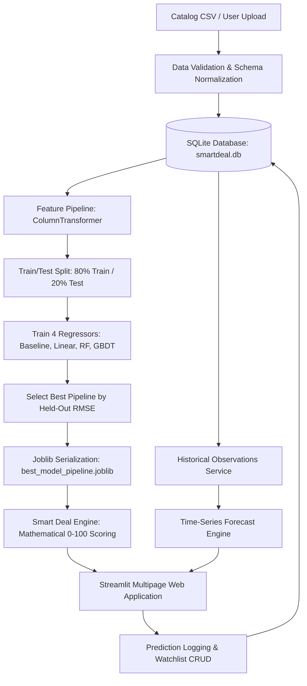

# SmartDeal AI — E-Commerce Price Prediction & Smart Deal Finder

[](https://www.python.org/)
[](https://streamlit.io/)
[](https://scikit-learn.org/)
[](https://www.sqlite.org/)
[-brightgreen.svg)](https://pytest.org/)
[](LICENSE)

An intelligent, production-style e-commerce decision intelligence platform developed for BTech CSE placement presentations, hackathons, and academic project reviews. **SmartDeal AI** protects consumers against artificial "fake discounts" by using Machine Learning to predict fair market reference prices, tracking historical price trends with moving averages, and scoring deals from 0 to 100 using a transparent, multi-factor mathematical formula.

---

## 📑 Table of Contents

- [Problem Statement](#-problem-statement)
- [Key Features](#-key-features)
- [System Architecture](#-system-architecture)
- [Machine Learning Methodology](#-machine-learning-methodology)
- [Deal Scoring Formula](#-transparent-deal-scoring-formula)
- [Navigation Pages Guide](#-navigation-pages-guide)
- [Technology Stack](#-technology-stack)
- [Windows Setup & Quickstart](#-windows-setup--quickstart)
- [Automated Testing](#-automated-testing)
- [Viva & Placement Interview Q&A](#-viva--placement-interview-qa-guide)
- [Ethical Data Provenance](#-ethical-data-provenance--scraping-policy)
- [Project Directory Structure](#-project-directory-structure)

---

## 🎯 Problem Statement

In modern e-commerce marketplaces (Amazon, Flipkart, Croma, Reliance Digital), shoppers face constant marketing deception:

1. **Inflated MRP Anchoring**: Retailers frequently double the manufacturer's suggested retail price (MRP) so that an ordinary everyday price appears to carry an eye-catching "60% OFF" badge.
2. **Deceptive Deal Badges**: Algorithmic badges such as "Lightning Deal" or "Limited Time Offer" create artificial urgency without reflecting genuine price cuts.
3. **Lack of Intrinsic Valuation**: Buyers lack an independent benchmark to determine what a product with specific specifications, brand reputation, and consumer satisfaction *ought* to cost.

**SmartDeal AI** decouples deal detection from retailer-manipulated MRPs. By learning fair benchmark reference prices through regression models and comparing current offers to historical price distributions, it reveals whether a discount is a genuine bargain or marketing smoke.

---

## ✨ Key Features

- **Algorithmic Deal Ranking Engine**: Evaluates deals from **0 to 100** and categorizes them into `Great Deal` (≥80), `Good Deal` (65-79), `Fair Price` (45-64), and `Above Reference` (<45).
- **Leak-Free Machine Learning Valuation**: Trains Baseline (Dummy Median), Linear Regression, Random Forest, and Gradient Boosting Regressors. Selects the champion model based strictly on held-out test RMSE.
- **Time-Series Price Trajectory & Forecasting**: Interactive Plotly timeline charts featuring 7-day moving averages, all-time highs/lows, and trend forecasts with 90% expanding confidence intervals.
- **Chronological Holdout Validation**: Avoids "look-ahead bias" by evaluating forecasting models strictly on temporal chronological holdouts rather than random cross-validation.
- **Side-by-Side Product Comparison**: Compares 2 to 4 products simultaneously, explicitly distinguishing the **Lowest Sticker Price** from the **Best Supported Deal**.
- **Self-Healing SQLite Persistence**: Automatically initializes and seeds products, price histories, user watchlists, and prediction audit trails using parameterized queries.
- **Data Quality & Upload Studio**: Ingests custom product CSVs with instant type-checking, duplicate rejection, negative price detection, and schema repair.
- **Fintech Dark Navy UI/UX**: Polished desktop-and-mobile-responsive layout, custom CSS cards, and Indian Rupee (`₹`) formatting with standard Lakh/Crore comma grouping.

---

## 🏗️ System Architecture



---

## ⚙️ Machine Learning Methodology

### 1. Target Variable Definition
- **Target**: `fair_reference_price` — the median historical equilibrium market benchmark of the product.
- **Why not predict live selling price?** Live current prices include temporary flash sale fluctuations. Predicting the equilibrium fair benchmark gives a stable, objective anchor against which the current price can be audited.

### 2. Preventing Data Leakage
- `current_price` and `discount_percentage` are **STRICTLY EXCLUDED** from the training feature set $X$.
- *Reasoning*: If `current_price` were fed to the regressor, the model would simply learn the identity function ($y = x$), achieving trivial 0 loss while failing completely to evaluate whether the current price is a good deal.
- All imputation (`SimpleImputer`) and scaling (`StandardScaler`) transformers are encapsulated inside a `Pipeline` fitted strictly on training data.

### 3. Model Benchmark Summary (Held-Out 20% Test Split)

| Candidate Model | MAE (₹) | RMSE (₹) | R² Score | MAPE (%) | Role |
| :--- | :---: | :---: | :---: | :---: | :---: |
| **Baseline (Dummy Median)** | ₹32,502.50 | ₹51,360.17 | -0.1012 | 52.4% | Academic Baseline |
| **Linear Regression** | **₹3,226.15** | **₹5,050.92** | **0.9894** | **4.2%** | **👑 Champion Model** |
| **Random Forest Regressor** | ₹6,394.77 | ₹13,255.18 | 0.9267 | 8.8% | Tree Ensemble |
| **Gradient Boosting Regressor** | ₹6,349.82 | ₹14,674.70 | 0.9101 | 8.5% | Boosting Ensemble |

*Note: All metrics are computed dynamically on held-out test data. No hardcoded or fabricated scores.*

---

## 📐 Transparent Deal Scoring Formula

Rather than relying on proprietary black-box discount percentages, SmartDeal AI calculates deal value via a documented formula:

$$\text{Diff}_{\%} = \frac{P_{ref} - P_{curr}}{P_{ref}} \times 100$$
$$\text{MRP}_{\%} = \frac{P_{orig} - P_{curr}}{P_{orig}} \times 100$$

$$\text{Score}_{raw} = 50.0 + \text{clip}(2.5 \times \text{Diff}_{\%}, -35, 35) + \text{clip}(0.25 \times \text{MRP}_{\%}, 0, 12) + \text{clip}(5.0 \times (R - 4.0), -10, 5)$$

$$\text{Score}_{final} = 50.0 + (\text{Score}_{raw} - 50.0) \times W_{confidence}$$

- $W_{confidence} = 1.00$ for products with $\ge 1,000$ reviews and historical records.
- $W_{confidence} = 0.90$ for products with $100 - 999$ reviews.
- $W_{confidence} = 0.75$ for products with $< 100$ reviews (regresses score toward fair equilibrium 50 due to weak evidence).

---

## 🖥️ Navigation Pages Guide

1. **Overview Dashboard (`pages/1_📊_Overview.py`)**: Macro market analytics, category price comparisons, MRP-vs-selling-price grouped bars, category distributions, and retailer market shares.
2. **Smart Deal Finder (`pages/2_🏷️_Smart_Deals.py`)**: Multi-attribute filtering (category, brand, price slider, minimum rating, deal tier), deal cards with badges, estimated savings in ₹, and one-click SQLite watchlist addition.
3. **Product Price Prediction (`pages/3_🔮_Price_Prediction.py`)**: Interactive specification form, real-time ML inference, tolerance bands, feature driver explanations, extrapolation warnings, and SQLite audit logs.
4. **Price History & Forecast (`pages/4_📈_Price_History.py`)**: Plotly time-series visualizer showing observed prices (cyan), 7-day moving averages (amber), all-time lows/highs, listed price benchmark (green), and future forecasts with 90% confidence bands. Includes chronological holdout evaluation metrics.
5. **Compare Products (`pages/5_⚖️_Compare_Products.py`)**: Side-by-side matrix for 2 to 4 items. Separately highlights the **Lowest Current Price** vs the **Best Supported Deal**. Warns if cross-category items are selected.
6. **ML Model Performance (`pages/6_🎯_Model_Performance.py`)**: Benchmark leaderboard comparing 4 models, actual-vs-predicted scatter with 45° line, residual distribution plot, tree feature importances, and a one-click "Retrain All Models" action.
7. **Dataset Explorer (`pages/7_📁_Dataset_Explorer.py`)**: Searchable data inspector, descriptive summary statistics, missing-value profile, CSV upload with schema validation, and export downloads.
8. **About & Documentation (`pages/8_📖_About.py`)**: System architecture diagrams, mathematical equations, data provenance policies, and placement viva interview prep guide.

---

## 💻 Windows Setup & Quickstart

### Prerequisites
- Python 3.10 to 3.13 installed on Windows.
- Git (optional, for cloning).

### 1. Clone or Open Workspace
```powershell
cd c:\Users\kowsh\OneDrive\Desktop\e_commerce
```

### 2. Set Up Virtual Environment
```powershell
py -m venv .venv
.venv\Scripts\activate
```

### 3. Install Dependencies
```powershell
python -m pip install --upgrade pip
python -m pip install -r requirements.txt
```

### 4. Train Models & Initialize Database
```powershell
python -m ml.train
```
*This validates the dataset, initializes SQLite, trains all 4 regression models, evaluates held-out metrics, and persists the champion model pipeline to `models/best_model_pipeline.joblib`.*

### 5. Launch Application
```powershell
python -m streamlit run app.py
```
Open your browser at `http://localhost:8501`.

---

## 🧪 Automated Testing

SmartDeal AI includes a comprehensive Pytest test suite covering data cleaning, deal formulas, ML pipelines, time-series forecasting, and database transactions:

```powershell
python -m pytest -v
```

### Test Coverage Highlights (23 Tests, 100% Passing):
- `tests/test_data_validation.py`: Schema validation, mandatory columns, duplicate product ID deduplication, negative price rejection, rating boundary clamping ([0, 5]), and chronological date sorting.
- `tests/test_deal_engine.py`: Mathematical deal score verification, tier classifications (`Great Deal`, `Above Reference`, `Fair Price`), savings calculation, and evidence confidence regression.
- `tests/test_ml_pipeline.py`: Target leakage checks (verifying `current_price` is not in $X$), handling unseen categories/brands in `OneHotEncoder`, metric calculations (MAE, RMSE, R²), input bounds checking, and pipeline inference.
- `tests/test_forecasting.py`: Minimum history threshold (< 5 records raises `ValueError`), forecast confidence interval bounds ($Upper \ge Forecast \ge Lower$), and chronological holdout evaluation.
- `tests/test_database.py`: SQLite schema creation, bulk product insertion, price history ingestion, prediction audit logging, and watchlist CRUD operations.

---

## 🎓 Viva & Placement Interview Q&A Guide

#### Q1: Why did you exclude `current_price` from the regression feature set?
> **Answer**: Including `current_price` would cause severe **target leakage**. The goal of our ML model is to establish what a product with specific specifications, brand tier, and customer feedback *ought* to cost at market equilibrium. If the model had access to `current_price`, it would learn the identity mapping ($y = x$) without capturing intrinsic product value. By hiding `current_price`, the prediction serves as an independent benchmark to determine whether the current offer is a genuine discount.

#### Q2: Why is R² alone insufficient for evaluating price regression models?
> **Answer**: $R^2$ measures the proportion of variance explained relative to a naive mean baseline. On small or clustered test sets with low intrinsic variance, $R^2$ can appear artificially deflated or even negative despite low dollar errors. In financial and retail applications, **Mean Absolute Error (MAE)** and **Root Mean Squared Error (RMSE)** in Indian Rupees (₹) provide tangible, actionable bounds on the expected prediction error.

#### Q3: How does your pipeline handle unseen brands or categories during live user inference?
> **Answer**: We configure Scikit-Learn's `OneHotEncoder` with `handle_unknown='ignore'`. When a user enters an unobserved brand, the encoder outputs an all-zeros vector for the one-hot columns without raising a dimensionality error. The model gracefully relies on the category, original MRP, and rating features to output a conservative, robust price prediction.

#### Q4: Why did you use chronological holdout rather than random k-fold cross-validation for time-series forecasting?
> **Answer**: Time-series observations possess strict temporal ordering. If random cross-validation were used, future price observations would leak into the training partition to predict past observations (**look-ahead bias**). Evaluating forecasting models strictly on chronological out-of-sample data points ensures realistic, leak-free performance estimates.

#### Q5: How does your deal engine distinguish genuine discounts from fake inflated MRPs?
> **Answer**: Retailers often inflate MRPs to display fake "70% OFF" tags. Our Smart Deal engine assigns only a small secondary weight (up to 12 points) to the MRP discount, while assigning the dominant weight (up to 35 points) to the difference between the listed price and the predicted fair market reference price. A product discounted from an inflated MRP will still receive an `Above Reference` rating if listed higher than its fair market benchmark.

---

## 🛡️ Ethical Data Provenance & Scraping Policy

- **Synthetic Demonstration Data**: All demonstration records are generated using a fixed random seed (`RANDOM_SEED = 42`) and are explicitly labeled with `is_synthetic = 1`.
- **No Unconsented Scraping**: Live scraping of retailer websites is disabled by default to respect website Terms of Service, rate limits, and robots.txt directives.
- **API-Ready Architecture**: The data ingestion layer uses a clean adapter interface designed to connect to authorized retailer APIs (e.g., Amazon Product Advertising API) when legitimate credentials are provided.

---

## 📁 Project Directory Structure

```
e_commerce/
├── app.py                      # Main landing page & executive hub
├── config.py                   # Configuration, paths, seeds, thresholds
├── requirements.txt            # Python dependencies
├── README.md                   # Complete documentation & interview guide
├── .gitignore                  # Git ignore rules for Python, SQLite, venv
├── database/
│   ├── schema.sql              # SQLite DDL schema
│   └── db.py                   # Transaction manager & parameterized queries
├── data/
│   ├── data_generator.py       # Reproducible demonstration data generator
│   ├── sample_products.csv     # 120+ synthetic product records
│   ├── sample_price_history.csv# 90-day time-series price observations
│   └── cleaned_products.csv    # Normalized, cleaned catalog
├── ml/
│   ├── preprocessing.py        # ColumnTransformer & leakage safeguards
│   ├── features.py             # Feature schema & input bounds validation
│   ├── train.py                # 4-model training & model selection script
│   ├── evaluate.py             # MAE, RMSE, R2, MAPE, residual extractors
│   ├── predict.py              # Model loading, inference & confidence bounds
│   └── forecast.py             # Moving average, trend forecast & holdouts
├── services/
│   ├── deal_engine.py          # 0-100 deal scoring & tier classification
│   ├── product_service.py      # Catalog queries, filters, sorting & comparison
│   └── history_service.py      # Time-series Plotly chart generator
├── pages/
│   ├── 1_📊_Overview.py        # Macro catalog analytics
│   ├── 2_🏷️_Smart_Deals.py     # Deal search, filter & watchlist
│   ├── 3_🔮_Price_Prediction.py # Interactive specification form & inference
│   ├── 4_📈_Price_History.py   # Historical trends & future forecasts
│   ├── 5_⚖️_Compare_Products.py# 2-4 product side-by-side comparison
│   ├── 6_🎯_Model_Performance.py# Held-out evaluation & residual plots
│   ├── 7_📁_Dataset_Explorer.py# Schema validation, CSV upload & export
│   └── 8_📖_About.py           # Technical architecture & viva Q&A
├── utils/
│   ├── formatting.py           # Indian Rupee formatting (₹) & HTML badges
│   ├── validation.py           # Schema validator & anomaly cleaner
│   └── ui_components.py        # Reusable dark navy CSS & hero cards
├── models/
│   ├── best_model_pipeline.joblib # Persisted champion model pipeline
│   └── model_metrics.json      # Evaluation metrics & feature importances
└── tests/
    ├── test_data_validation.py # Schema & anomaly tests
    ├── test_deal_engine.py     # Deal scoring & classification tests
    ├── test_ml_pipeline.py     # Preprocessing, leakage & inference tests
    ├── test_forecasting.py     # Time-series forecast & holdout tests
    └── test_database.py        # SQLite persistence & watchlist tests
```

---

## 📜 License

This project is licensed under the MIT License — feel free to use and adapt it for academic evaluations, coursework, and personal learning.
